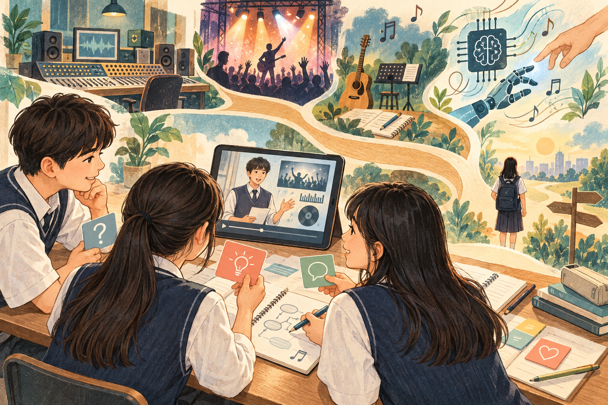
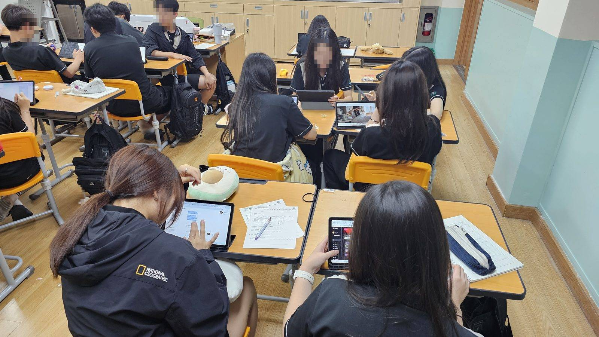
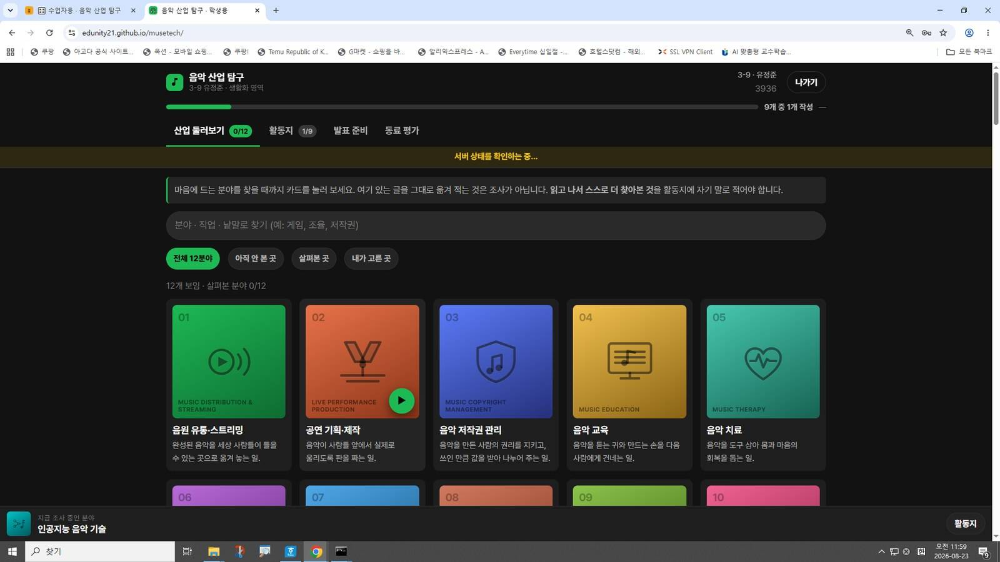

# 음악으로 먹고사는 사람들

**음악 산업 12개 분야를 조사하여 1분으로 말하기**  
중학교 3학년 음악 · 4차시 · 유정준 / 순천승평중학교

> **음악이 사라지면, 그 산업에서는 무엇이 함께 사라지는가?**

[상세 단원수업설계안](docs/unit-plan.md) · [학생 활동지](docs/worksheet.md) · [자료·이미지 출처](docs/sources.md) · [업로드 안내](UPLOAD.md)

## 01 · 듣는 음악에서 일하는 음악으로

학생은 매일 음악을 듣지만, 그 음악을 옮기고 지키고 무대에 올리는 사람들의 일은 쉽게 보지 못한다. 원 설계안의 3학년 사전 조사에서는 음악과 자신의 삶을 연결하는 데 어려움이 나타났다(192명, M=2.73, 긍정 21.9%). 이 단원은 음악을 둘러싼 산업과 직업을 탐구하며 **음악의 활용 가치를 자기 삶과 진로의 언어로 설명하는 경험**을 만든다.

## 02 · “음악이 없다면?”으로 가치를 발견하기

핵심은 산업 이름을 많이 아는 데서 끝나지 않는다. 학생은 관심 분야 하나를 골라 음악이 쓰이는 구체적 장면을 찾고, **음악을 지웠을 때 무엇이 사라지고 누가 곤란해지는지** 설명한다. “음악은 분위기를 좋게 한다”를 넘어 그 산업의 일과 음악의 관계를 밝히는 것이 목표다. 성취기준은 **[9음03-02] 음악과 관련된 산업에 대해 조사하여 발표한다**이며, 교육과정 표기는 원 설계안을 따른다.

## 03 · 배움의 증거는 활동지와 1분 발표

학생은 서로 다른 조사처 두 곳 이상에서 찾은 내용을 **자기 말로 정리한 9문항 활동지**와 **50초~1분 발표 영상**으로 보여 준다. 산업 조사 40점, 음악의 활용 가치 30점, 발표 수행 30점으로 평가하며, 동료평가는 피드백에만 사용한다. 특히 7번 문항에서 음악이 없을 때 사라지는 것을 산업의 일과 연결하는 설명이 활용 가치 영역의 상 수준을 판단하는 핵심 증거다.

## 04 · 네 차시로 완성하는 산업 리포트

**둘러보기와 선택 → 조사와 해석 → 1분 영상 발표 → 피드백과 진로 연결**로 학습이 이어진다. 12개 분야의 자료집은 조사의 실마리를 제공하고, 학생은 검색과 비교를 통해 내용을 보완한다. 세 문장과 60초의 제약은 무엇을 남기고 덜어낼지 스스로 판단하게 한다. 수업 시간 안에서 조사·저장·제출하도록 운영하며, 영상 녹화는 학생별로 수행하고 함께 보기는 학급 시간에 맞추어 운영한다.

| 차시 | 중심 활동 | 남기는 증거 |
| --- | --- | --- |
| 1차시 | 산업 둘러보기, 분야와 선택 이유 정하기 | 활동지 1~2번 |
| 2차시 · 본시 | 산업 조사, 음악의 활용 가치 설명, 세 문장 정리 | 활동지 3~9번 및 제출본 |
| 3차시 | 발표 연습, 영상 촬영·제출, 동료 감상 | 1분 발표 영상, 동료 피드백 |
| 4차시 | 성취수준별 피드백, 질의응답, AI 시대의 진로 토의 | 진로 연결 문장, 보완한 설명 |

## 05 · 본시의 중심은 ‘자기 말로 설명하기’

2차시는 **도입 6분, 전개 32분, 정리 7분**으로 구성한다. 소리가 있는 게임 장면과 없는 장면을 비교한 뒤, 산업 조사 13분·활용 가치 탐구 12분·발표용 세 문장 정리 7분을 진행한다. 교사는 “친구에게 말로 설명해 볼래?”라고 묻고, 학생은 짝과 7번 답을 읽으며 산업의 일과 연결되는지 점검한다. AI는 낯선 용어와 검색어를 이해하는 보조 도구로 활용하되 핵심 서술과 발표는 학생이 직접 수행한다.

## 06 · 평가 다음에 이어지는 진로의 문장

피드백은 마지막 시간에만 이루어지지 않는다. 분야 선택 확인, 조사 중 순회 질문, 짝 점검, 다시 촬영하기, 동료의 궁금한 점이 네 차시에 걸쳐 연결된다. 마지막에는 7번 우수 문장을 익명으로 살펴보고 **“AI가 음악을 만드는 시대에도 음악 산업의 일은 사람의 몫으로 남을까?”**를 토의한다. 학생은 나와 분야의 연결을 진로 문장으로 다시 쓰며 배움을 확장한다.

## 탐구할 음악 산업 12개 분야

| 음악을 만들고 전하기 | 음악을 활용하고 경험하기 | 음악의 생태계를 지원하기 |
| --- | --- | --- |
| 음원 유통·스트리밍 | 음악 교육 | 악기 제조·유통 |
| 공연 기획·제작 | 음악 치료 | 음향 엔지니어링 |
| 음악 저작권 관리 | 영상 음악 | 음악 저널리즘·평론 |
| 아티스트 매니지먼트 | 게임 음악 | 인공지능 음악 기술 |

*표의 세 묶음은 읽기 편하도록 편집한 분류이며, 분야 이름은 원 설계안을 따릅니다.*

## 관련 자료 사진

관련 파일에서 찾은 사진과 화면 자료는 [사진 자료실](docs/photos.md)에 출처와 함께 정리했습니다. 해당 단원의 실제 실시 장면으로 확인되지 않은 이미지는 관련 교육활동 자료로 표시했습니다.

*관련 음악 교육활동 사진 · 연구보고서 내장 이미지 BIN003E.jpg · 원본 모자이크 유지.*

*음악 산업 탐구 플랫폼의 학생용 화면 기록 · 연구보고서 내장 이미지 BIN003B.jpg.*

## 문서 구성

| 파일 | 내용 |
| --- | --- |
| [상세 단원수업설계안](docs/unit-plan.md) | 설계 의도, 목표, 평가 과제, 루브릭, 4차시 계획, 본시 45분 지도안 |
| [학생 활동지](docs/worksheet.md) | 원 설계안에 근거해 재구성한 9문항과 발표 준비·성찰 양식 |
| [사진 자료실](docs/photos.md) | 다른 자료에서 추출한 관련 이미지와 설명 |
| [출처 및 편집 기록](docs/sources.md) | 원본 파일, 보존한 수치, 편집 범위, 이미지 출처 |
| [이미지 생성 프롬프트](docs/illustration-prompts.md) | 여섯 일러스트의 제작 방식과 최종 프롬프트 |
| [깃허브 업로드 안내](UPLOAD.md) | 파일 배치와 이미지 경로 안내 |

---

원안: 유정준 · 순천승평중학교 / 문서화: 2026-10-10. 일러스트 6장은 AI로 제작한 개념 설명용 그림입니다. 이 묶음은 수업설계안 공개용 문서이며, 학생 로그인·평가 제출을 실행하는 플랫폼은 포함하지 않습니다.
